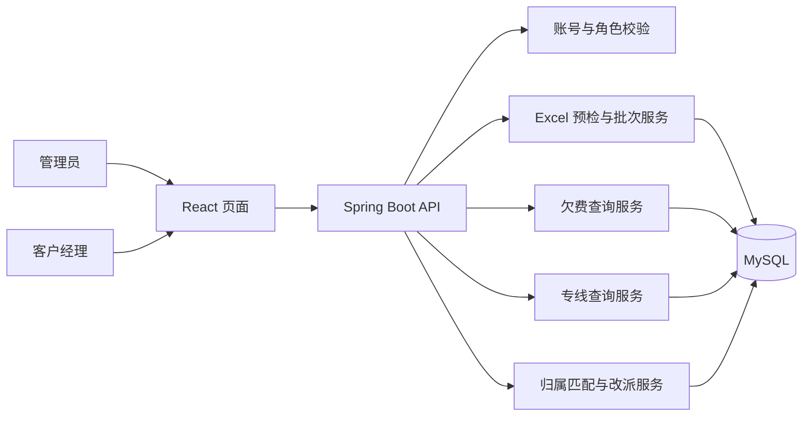

# 集团欠费与专线到期数据管理设计

| 项目 | 内容 |
|---|---|
| 文档状态 | 当前产品基线；V1–V8 数据库迁移、旧模块清理及永久删除流程已实现 |
| 更新日期 | 2026-11-11 |
| OpenSpec 变更 | `independent-excel-ledgers` |
| 旧技术归档 | [`docs/project-technical-archive/`](../project-technical-archive/)（保留，不覆盖） |
| 依据 | 用户确认的业务规则、两份真实 Excel 表头、现有项目技术栈与旧技术说明 |

> 本文记录当前设计和实施进展。旧客户台账、风险规则、旧导入和手工任务模块已从当前代码与数据库结构中移除；历史技术描述仅保留在归档文档。两种真实 Excel 快照继续互相独立。

## 1. 背景与目标

管理员每月上传两种汇总表：集团账户欠费明细月表、专线到期需续签明细表。两种数据来源分开存储、分开导入、分开查询、分开授权，不建立欠费账户与专线实例之间的业务关联。集团编码在两张表中都作为展示和查询字段，但不作为两套业务数据的关联外键。

管理员可以查看所有记录、导入批次和归属匹配异常。客户经理登录后，只能查看当前有效归属为自己的欠费或专线记录。系统按 Excel 中的客户经理姓名与账号真实姓名精确匹配；无法唯一匹配的记录保留在系统中，由管理员逐行或批量分配。

首版的目标是可靠导入、展示和追溯两套数据，并为专线快照提供可追溯的人工续签工单。暂不包含风险阈值、风险等级、风险任务和提醒等自动化业务。

## 2. 本次范围与明确排除

### 范围内

- 管理员逐个创建、查询和停用账号；不做客户经理名单批量导入或自助注册。
- 两种独立 Excel 的上传预检、差异预览、确认导入、版本历史和批次追溯。
- 独立的“欠费明细”和“专线到期明细”页面，以及管理员可见的“导入批次”和“归属匹配异常”页面。
- 按当前有效客户经理实施逐记录权限过滤；归属按数据类型和统计快照隔离。
- 列表筛选、历史日期切换、详情抽屉、分页、排序和权限范围内导出。
- 保留所有有表头的 Excel 原始字段和值，忽略空表头列。

### 范围外

- 欠费和专线之间的关联、跨来源客户经理自动同步或集团级自动分配。
- 账龄/欠费金额风险判断、停机风险、到期风险、风险等级、督办任务和通知。
- 对外系统同步、短信/邮件/企业微信、云端服务、Docker、通用报表平台。
- 自动继承上一统计日期人工归属；每次新导入都按本次 Excel 姓名重新匹配。

## 3. 真实 Excel 来源与字段契约

### 3.1 欠费明细月表

参考文件：`9月集团账户欠费明细月表.xlsx`。文件中的“日期”字段为月份统计标识（示例值 `202609`），以该字段作为欠费统计月份，不依据文件名猜测日期。

欠费行的稳定标识为“账户 ID + 日期”。`账户ID` 跨月份保持不变；同一统计月份内 `账户ID` 不得重复。`集团客户经理姓名` 用作 Excel 原始归属匹配字段；Excel 中的 `集团客户经理ID` 仍作为原始字段保留，但不替代姓名匹配。

必填字段：

| Excel 列名 | 用途 |
|---|---|
| 日期 | 欠费统计月份 |
| 集团编码 | 集团查询与展示 |
| 集团名称 | 集团查询与展示 |
| 集团客户经理姓名 | 原始归属及账号精确匹配 |
| 账户ID | 月度快照业务键 |
| 期末欠费金额 | 列表展示 |

`承载产品名称`、`账龄`以及其他有表头字段均为可选字段。字段存在且有值时按原始列保留并用于相应展示/筛选；为空时不阻断导入。

### 3.2 专线到期明细表

参考文件：`10月底到期需续签明细.xlsx`。统计日期以 Excel 的“统计日期”字段为准（示例值 `20260901`），文件名中的月份只作为说明，不能覆盖工作簿中的日期字段。

专线行的稳定标识为“成员服务号码 + 统计日期”。`成员服务号码` 用作专线实例快照业务键。`资管系统产品实例标识` 等其他有表头字段保留在原始字段详情中，不替代已确认的成员服务号码键。

必填字段：

| Excel 列名 | 用途 |
|---|---|
| 统计日期 | 专线快照统计日期 |
| 集团编码 | 集团查询与展示 |
| 集团名称 | 集团查询与展示 |
| 成员服务号码 | 专线快照业务键 |
| 客户经理姓名 | 原始归属及账号精确匹配 |
| 计费截止日期 | 剩余天数计算和范围筛选 |

`产品编码`、`产品名称`以及其他有表头字段均为可选字段。字段存在且有值时按原始列保留并用于相应展示/筛选；为空时不阻断导入。

### 3.3 完整原始表头清单

详情和导出保留工作簿中所有非空表头字段，按原始 Excel 列顺序展示。空表头列不入库、不展示、不导出。相同的非空表头按列位置分别保存，详情中追加列位置以便区分。下面按列号记录首版真实文件的表头。

欠费表（第 14 列为空表头，因此忽略）：

| 列号 | 表头 | 列号 | 表头 | 列号 | 表头 |
|---:|---|---:|---|---:|---|
| 1 | 日期 | 2 | 区县 | 3 | 集团编码（第 3 列） |
| 4 | 集团名称 | 5 | 集团编码（第 5 列） | 6 | 集团客户号 |
| 7 | 集团价值级别 | 8 | 集团客户经理ID | 9 | 集团归属 |
| 10 | 集团客户经理姓名 | 11 | 催缴日期 | 12 | 回执日期 |
| 13 | 回执状态 | 15 | 集团客户经理电话 | 16 | 承载产品编码 |
| 17 | 承载产品名称 | 18 | 承载产品计费ID | 19 | 承载产品计费号 |
| 20 | 承载产品大状态ID | 21 | 承载产品大状态 | 22 | 承载产品小状态ID |
| 23 | 承载产品小状态 | 24 | 账龄 | 25 | 账龄1月欠费金额 |
| 26 | 账龄2月欠费金额 | 27 | 账龄3月欠费金额 | 28 | 账龄4-6月欠费金额 |
| 29 | 账龄7-12月欠费金额 | 30 | 账龄1-2年欠费金额 | 31 | 账龄2-3年欠费金额 |
| 32 | 账龄3-4年欠费金额 | 33 | 账龄4-5年欠费金额 | 34 | 账龄5年以上欠费金额 |
| 35 | 账户ID | 36 | 账户名称 | 37 | 期末欠费金额 |
| 38 | 坏账计提金额 | 39 | 欠费净值 | 40 | 期末欠费金额含呆坏帐 |
| 41 | 呆坏账占比 | 42 | 最早欠费账期 | 43 | 最早欠费账期欠费金额 |
| 44 | 最晚欠费账期 | 45 | 最晚欠费账期欠费金额 | 46 | 本月新增欠费金额 |
| 47 | 本年新增欠费金额 | 48 | 本年新增欠费金额含带坏账 | 49 | 缴费周期 |
| 50 | 本月回收现金金额 | 51 | 行业大类编码 | 52 | 行业大类名称 |
| 53 | 是否黑名单 | 54 | 归类后产品名称 | 55 | 逾期欠费状态 |
| 56 | 逾期欠费金额 | 57 | 账户本期超过缴费周期欠费账龄 | 58 | 账户上期超过缴费周期欠费账龄 |
| 59 | 本月回收逾期欠费金额 | 60 | 本月新增逾期欠费金额 | 61 | 是否呆坏账 |
| 62 | 近一年缴费金额 | 63 | 是否为上月小额欠费单位 | 64 | 当月集团客户信用评级结果 |
| 65 | 合同缴费周期 | 66 | 省内细分行业 | 67 | 集团客户经理信用等级 |
| 68 | 企业类型 | 69 | 归属账龄 | 70 | 往年欠费金额 |
| 71 | 本年回收现金金额 | 72 | 本年回收往年欠费金额 | 73 | 本年回收新增欠费金额 |
| 74 | 政企客户类型 | 75 | 企业规模 | 76 | 是否关联方 |
| 77 | 社会信用统一代码 | 78 | 集团行业分类 | 79 | 上月期末欠费金额（万元） |
| 80 | 上月账龄归属 | 81 | 催缴工单下发时间 | 82 | 催缴客户类型 |
| 83 | 客户欠费原因 | 84 | 预计回款金额（元） | 85 | 计划回款时间 |
| 86 | 当前催缴阶段 | 87 | 当前催缴阶段提交时间 | 88 | 是否走法律催缴 |
| 89 | 催缴短信下发数量 | 90 | 催缴工单下发数量 | 91 | 催缴工单回单数量 |
| 92 | 是否达到停机标准 |  |  |  |  |

专线表：

| 列号 | 表头 | 列号 | 表头 | 列号 | 表头 |
|---:|---|---:|---|---:|---|
| 1 | 统计日期 | 2 | 存量维度名称 | 3 | 地市名称 |
| 4 | 区县名称 | 5 | 网格名称 | 6 | 集团编码 |
| 7 | 集团名称 | 8 | 集团价值级别 | 9 | 产品编码 |
| 10 | 产品名称 | 11 | 成员用户编码 | 12 | 成员服务号码 |
| 13 | 是否注销 | 14 | 注销日期 | 15 | 成员状态 |
| 16 | 行业类别名称 | 17 | 客户经理姓名 | 18 | 客户经理联系电话 |
| 19 | 当前发展人工号 | 20 | 发展工号归属网格所属地市编码 | 21 | 发展工号归属网格所属地市名称 |
| 22 | 发展工号归属网格所属区县名称 | 23 | 发展工号归属网格所属区县名称1 | 24 | 发展工号归属网格编码 |
| 25 | 发展工号归属网格名称 | 26 | 宽带接入速率 | 27 | 录入系统时间 |
| 28 | 计费开始日期 | 29 | 计费截止日期 | 30 | 合同到期日 |
| 31 | 专线ARPU值 | 32 | 和飞速A套餐档次 | 33 | 资管系统A端地址 |
| 34 | 资管系统Z端地址 | 35 | 资管系统产品实例标识 | 36 | 1月出账收入金额 |
| 37 | 2月出账收入金额 | 38 | 3月出账收入金额 | 39 | 4月出账收入金额 |
| 40 | 5月出账收入金额 | 41 | 6月出账收入金额 | 42 | 7月出账收入金额 |
| 43 | 8月出账收入金额 | 44 | 9月出账收入金额 | 45 | 10月出账收入金额 |
| 46 | 11月出账收入金额 | 47 | 12月出账收入金额 | 48 | 当年累计出账金额 |
| 49 | 当月资费订购金额 | 50 | IP地址数量 | 51 | 接入方式 |
| 52 | 路由保护方式 | 53 | A端传输接入方式 | 54 | Z端传输接入方式 |
| 55 | 是否自用 | 56 | 是否校园宽带出口 | 57 | 是否试用 |
| 58 | 是否办理融合包 |  |  |  |  |

### 3.4 导入解析约定

已对项目内两份真实工作簿逐列核验：欠费表工作表为 `Sheet1`，共 92 列，第 14 列表头为空，其余 91 列均有表头；“集团编码”分别位于第 3、5 列。专线表工作表为 `Sheet1`，共 58 列，全部有表头且无重复表头。欠费样例中第 3、5 列“集团编码”在所有数据行一致，规范化查询字段固定取第 3 列；第 5 列仍作为独立原始字段保留。

- 解析表头行时保留原始列号；表头去除首尾空白后为空的列整体忽略。非空重复表头按 `(列号, 表头)` 区分，不合并、不覆盖。要求字段按本节列出的表头名识别；有重名的字段必须按已核验列号绑定。
- 以上两份文件均只有一个数据工作表 `Sheet1`，表头在第 1 行，数据从第 2 行开始。批次仍记录实际工作表名和 Excel 原始行号；完全空白的数据行跳过，不改变后续行号。
- 欠费“日期”是月份键，只接受合法 `yyyyMM` 月份值（样例为数值 `202609`）；专线“统计日期”及用于剩余天数的“计费截止日期”只接受合法 `yyyyMMdd` 日期值（样例为数值 `20260901`、`20261031`）。支持 Excel 数值单元格和相同位数的纯数字文本，不从文件名推断，不把月份键补成某个具体日。其他有表头日期列作为原始字段保存，不参与日期键解析。
- 金额使用十进制定点数解析，不经二进制浮点转换；接受 Excel 数值单元格或去除首尾空白后的标准十进制文本，空格、千分位逗号、非数值文本和非有限数均判为格式错误。`0` 是有效值。`账龄`按原值保留并展示，不据此计算风险。
- 账户 ID、集团编码、产品编码和成员服务号码作为标识按文本保存；文本值保持原样，数值单元格仅在能无损表示为整数时转换为十进制整数字符串，不使用科学计数法。任何规范化都不覆盖原始字段值；原始工作簿字节另行完整保存。
- 每种来源的统计日期和业务键必须齐全且在本批次内唯一；同一键重复或必填业务字段无法解析时阻断确认并定位到工作表和原始行号。欠费必填字段为日期、集团编码、集团名称、集团客户经理姓名、账户 ID、期末欠费金额；专线必填字段为统计日期、集团编码、集团名称、成员服务号码、客户经理姓名、计费截止日期。产品编码、产品名称、承载产品名称、账龄及其他字段均可为空。必填的 Excel 客户经理姓名为空时阻断确认；姓名有值但未命中账号或命中多个同名账号时，作为归属匹配异常保留，不阻断导入。

## 4. 系统架构与数据设计

### 4.1 技术架构

延续当前本地模块化单体技术栈：React + TypeScript + Vite 前端，Java 17 + Spring Boot + Spring JDBC 后端，MySQL 数据库，Apache POI 解析 Excel。浏览器通过受保护的 REST API 访问本地服务。权限校验在服务端执行，前端隐藏菜单不能替代后端权限过滤。



### 4.2 逻辑数据模型

| 数据对象 | 作用 | 关键约束 |
|---|---|---|
| 导入批次 | 记录来源、日期、文件名与指纹、原始工作簿引用、操作人、状态、当前/历史版本、校验和差异摘要 | 当前版本按“来源 + 统计日期”唯一；每次上传尝试均可追溯到原始文件 |
| 原始工作簿文件 | 原样保存每次完整接收的 Excel 字节，供批次追溯和管理员下载 | 按批次关联且不可变；成功、失败、重复尝试都保留；不自动删除 |
| 欠费快照行 | 存储欠费字段的规范化查询列和原始字段 | `账户ID + 日期` 在欠费快照内唯一 |
| 专线快照行 | 存储专线字段、计费截止日期和规范化查询列 | `成员服务号码 + 统计日期` 在专线快照内唯一 |
| 专线续签工单 | 维护专线日期快照的当前处理状态、最后处理人/时间和当前快照引用 | `(统计日期, 成员服务号码)` 唯一，仅专线使用 |
| 专线续签状态历史 | 保存每次实际状态变化的前后状态、操作人和时间 | 追加保存，不覆盖旧变化 |
| 原始字段集合 | 保存所有非空表头字段和值、列顺序、工作表和原始行号 | 重复表头以列位置区分；空表头不保存 |
| 当前有效归属 | 每条快照行关联一个客户经理账号或为空 | 欠费、专线、日期、行记录互相隔离 |
| 归属处理历史 | 保存每次人工分配/改派的前后归属、操作者和时间 | 仅追加历史，不覆盖 Excel 原始姓名 |
| 归属异常 | 记录无匹配/多重匹配的来源、行、原因和处理状态 | 一条异常对应一条源记录，不按集团合并 |
| 客户经理账号 | 登录名、真实姓名、角色、启停状态 | 登录名唯一，真实姓名允许重复 |

`集团编码` 在两种快照中用于查询与展示，不建立跨来源外键。每个批次正式确认后保留为只读快照；新版本只切换该来源、该日期的当前版本指针，旧快照仍可通过批次追溯。

关系型结构增量定义在 [`V2__independent_excel_ledgers.sql`](../../db/migrations/V2__independent_excel_ledgers.sql)，在 V1 后执行。`excel_source_file` 按 SHA-256 对原始字节去重并保存相对存储键和字节数；`excel_import_batch` 每次上传尝试单独留档，并用来源、统计键、状态和时间建立查询索引。欠费统计键存 `yyyyMM`，专线统计键存 `yyyyMMdd`。`excel_current_version` 以 `(source_type, statistics_key)` 为主键，并通过含来源和日期的复合外键指向批次，数据库因此最多允许同一来源/日期一个当前版本。

`excel_import_row` 按批次、工作表、原始行号唯一保存预览中的原始字段、规范化字段及问题；原始字段 JSON 项按列号保留，可区分重复表头，并按稳定序列化内容计算行 SHA-256。`excel_revision_diff` 将候选行与前版本行按来源业务键记录为新增、删除、变更或不变；不比较工作表行号，字段哈希相同才视为不变。修正版预览返回前版本批次 ID、四类数量及逐键差异，只有有效候选行参与分类；阻断校验的候选不与当前版本比较。确认后的每行在 `excel_snapshot_record` 中保存本次 Excel 客户经理姓名及系统当前有效客户经理；`arrears_snapshot` 和 `line_expiry_snapshot` 分别以 `batch_id + account_id`、`batch_id + member_service_number` 唯一，并以固定 `source_type` 检查和复合外键拒绝把一来源的基础记录写进另一来源表。两种子表没有相互外键或共用业务身份键。

`assignment_exception` 和 `assignment_history` 均引用单条快照基础记录，来源、日期、集团和原始行号由批次/预览行关联取得，不按集团合并。`app_user` 继续使用 V1 已定义的唯一登录名、真实姓名、角色和启停状态；真实姓名不唯一，并增加 `(role, enabled, real_name, id)` 索引以支持精确匹配同名账号。来源数据的分页授权通过快照行上的 `effective_manager_user_id` 执行。

专线续签工单和状态历史定义在 [`V4__line_renewal_work_orders.sql`](../../db/migrations/V4__line_renewal_work_orders.sql)。工单以 `(statistics_key, member_service_number)` 唯一，关联当前专线快照并默认处于“待处理”；最后处理人和时间首次状态变化后才写入。状态历史只追加实际变化，记录原状态、新状态、操作人和时间。V4 幂等初始化当前专线快照，不生成虚构历史。修正版确认时先按批次编号升序锁定同一来源、统计日期的候选批次，再锁当前批次及工单自然键；复用既有工单并仅更新当前快照引用，保留人工状态信息；新成员服务号码创建待处理工单。独立数据库约束和幂等初始化验证脚本为 [`V4_line_renewal_work_orders_constraints.sql`](../../db/tests/V4_line_renewal_work_orders_constraints.sql)。

每次完整接收的原始工作簿必须在解析前以不可变方式保存，并关联到对应上传尝试批次；成功、校验失败、重复文件和修正版均保留。默认文件目录为仓库根目录下 `.runtime/ledger-original-workbooks`，可通过 `LEDGER_WORKBOOK_DIRECTORY` 指定其他持久化目录。文件按 SHA-256 内容寻址；`excel_source_file` 保存 SHA-256、相对存储键和字节数，相同内容可复用物理文件，但每次上传尝试都新建自己的批次记录和引用。管理员可通过 `/api/ledger-imports/{batchId}/original` 下载原文件，客户经理不可访问；常规业务不自动删除原件。V8 允许管理员在确认永久删除台账记录时可选销毁关联整份工作簿；所有引用批次会显示原件已销毁或待重试状态，原件清理失败会自动重试。原文件存储必须与数据库一同备份和恢复，并纳入存储空间监控。上传预检入口为管理员专用 `/api/ledger-imports/precheck?sourceType=ARREARS|LINE_EXPIRY`，每次尝试先留存原件和 `RECEIVED` 批次，再解析并保存行级预览；不可解析或字段校验阻断的批次标记 `BLOCKED`，同来源同内容重复文件标记 `DUPLICATE`，通过校验的批次标记 `PRECHECKED`。失败、重复尝试不写入正式快照。V1–V6 建立当前数据结构；V7 在备份后删除不再支持的旧客户台账、风险、旧任务和旧导入表。数据库迁移不会通过应用启动自动运行。

永久删除只接受台账页面当前版本中选中的记录，并按来源、统计期、业务唯一键清除该范围下所有批次和合并版本中的导入行、快照、差异、归属记录与关联工单历史；其他业务键、其他统计期和另一来源不变。预览短时有效、绑定管理员和当前版本且只能使用一次；确认前展示删除数量、共享工作簿影响并要求输入“永久删除”。操作保留最小审计，不写入被删业务键和字段。删除不会清理数据库外部备份或其他副本，恢复旧备份可能让已删除数据重新出现。

### 4.3 导入状态流程

```text
完整接收上传文件并不可变保存原文件
   |
   v
解析与预检 ---- 无法解析/缺日期/缺必填/重复主键 ----> 阻断并保留失败批次及原文件
   |
   +---- 同来源同日期已有当前版本、文件不同 ----> 差异预览
   |
   +---- 客户经理不匹配 ------------------------> 警告，保留异常行
   v
管理员确认
   |
   v
事务写入快照 + 设置当前版本；旧版本保留可追溯
```

相同来源同一文件指纹再次上传时提示重复，保留重复尝试批次及其原文件引用，不写业务快照。相同来源、相同统计日期、内容不同的文件作为修正版，预览新增/删除/变更记录；有阻断错误时禁止确认，只有警告时仍可确认。不同数据来源的上传互不覆盖。

## 5. 账号与归属规则

- 管理员在系统内逐个创建、查询、停用客户经理账号；首版不导入员工名单，不提供自助注册。
- 登录名默认采用姓名拼音；拼音冲突时管理员添加区分后缀，登录名必须唯一。
- `real_name` 是 Excel 客户经理姓名的精确匹配值和界面展示值。可存在多个同名账号，但导入时不会自动猜测，标记归属匹配异常。
- 欠费表只用“集团客户经理姓名”匹配；专线表只用“客户经理姓名”匹配。其他经理 ID/工号仍作为原始字段保留。
- 每行分别保存 Excel 原始客户经理姓名和系统当前有效客户经理。人工分配/改派只更新当前有效归属，原始姓名始终不变。
- 异常列表按源记录逐行展示。管理员可全选当前页或选择当前筛选结果全部记录，选择目标客户经理并确认数量后批量分配。一次批量操作只涉及一种数据来源；同一集团的多条记录可分别分配。
- 已处理记录允许再次改派；每次保存操作者、时间、原归属、新归属。未分配记录显示“未分配（归属匹配异常）”。
- 每次导入按本次 Excel 重新匹配，不继承历史人工分配。历史日期的归属独立保存和授权，改派只影响选中的来源/快照/记录。

## 6. 页面与筛选设计

### 6.1 全局页面原则

- 两类数据在导航和页面上完全独立：`欠费明细`、`专线到期明细`。
- 管理员可看全部记录、上传数据、查看批次和处理归属异常；客户经理只看当前有效归属为本人的记录。
- 两个页面默认仍显示最新成功导入日期的当前版本；日期筛选改为范围选择，用户可查看所选范围内各统计日期的当前版本。相同日期的修正版确认后成为当前版本；历史批次仍可由管理员从导入批次记录追溯。
- 详情在右侧抽屉打开，不离开列表。详情按 Excel 原列顺序显示所有有表头字段；空值显示“—”，数值 0 显示“0”。
- 两页默认每页 20 条，可切换 50、100；翻页保留日期范围和其他筛选条件。
- 当前筛选结果的导出不受当前页分页限制。

### 6.2 欠费明细

主列表同时显示 Excel 原始客户经理和当前有效客户经理，并固定展示：日期、集团编码、集团名称、Excel 原始客户经理、当前有效客户经理、账户 ID、承载产品名称、期末欠费金额、账龄。

筛选：统计月份范围、集团编码/名称关键词、账户 ID、承载产品名称、当前有效客户经理（管理员可选；客户经理默认限定本人）。首版不提供欠费金额范围、账龄和停机标准筛选。

默认排序：集团编码、账户 ID。`是否达到停机标准` 只在详情中显示。

### 6.3 专线到期明细

主列表同时显示 Excel 原始客户经理和当前有效客户经理，并固定展示：统计日期、集团编码、集团名称、产品编码、产品名称、成员服务号码、Excel 原始客户经理、当前有效客户经理、计费截止日期、剩余天数和续签处理状态。

`剩余天数 = 计费截止日期 - 系统当前日期`，可以为负数，查看历史快照时也按当前日期动态计算。`合同到期日`不参与计算、筛选或排序；`合同到期日`和`成员状态`只在详情显示。

筛选：统计日期范围、集团编码/名称关键词、产品编码/名称关键词、当前有效客户经理、续签处理状态、剩余天数最小值/最大值。统计日期和剩余天数范围均包含边界；剩余天数留空表示该侧不限，允许负数。默认剩余天数升序；相同剩余天数按集团编码、成员服务号码排序。不增加最后处理时间范围筛选。

续签处理状态只能是“待处理、跟进中、已续签、不续签”之一，允许任意状态切换；详情显示最后处理人、最后处理时间和全部状态变更历史。管理员可导出固定字段续签工单报表，原始专线明细导出保持原 Excel 有表头字段规则。

### 6.4 归属匹配异常

仅管理员可访问。逐行展示数据来源、统计日期、集团编码/名称、Excel 客户经理姓名、失败原因、批次、工作表、原始行号、处理状态和当前有效归属。支持按来源、统计日期、集团、Excel 姓名、批次、处理状态筛选；可查看未处理和已处理记录。

管理员可以全选当前页或全选当前筛选结果。批量分配确认前显示选择数量和目标客户经理；一批只能操作一种来源。已处理记录可再次改派，保留完整操作历史。

### 6.5 导入批次

仅管理员可访问。批次列表展示文件名、数据来源、统计日期、上传时间、操作人、状态、当前/历史版本标记和归属异常数。支持按来源、日期和状态筛选。详情展示校验结果、修正版差异、行计数、异常数量、工作表和原始行号，并提供原始工作簿下载。下载文件与上传时字节完全一致，可用 SHA-256 校验；客户经理不能查看或下载原始工作簿。

校验失败和重复文件的上传尝试也保留批次记录和原始工作簿，但不会写入正式业务数据。业务快照确认失败时整体回滚，并记录失败原因；原文件继续保留以供管理员追溯。

重复文件按同一数据来源下的 SHA-256 判定；已取消、已判重复和写入失败的批次不参与后续判重。这样管理员取消误上传或遇到写入失败后，可以重新上传同一工作簿，而重复尝试本身不会形成阻止重试的循环；已确认、待确认或校验阻断的同文件批次仍会触发重复提示。

## 7. 导入、展示和权限验收标准

### 7.1 导入校验

以下任一情况阻止整批确认，并显示工作表、原始行号和具体原因：文件不可解析、缺少统计日期/必填表头/必填值、同一来源快照业务键重复。非必填字段为空或客户经理匹配异常为警告，不阻止确认。空表头不保留；重复非空表头按列位置单独保留。

### 7.2 必填字段

| 来源 | 必填字段 |
|---|---|
| 欠费 | 日期、集团编码、集团名称、集团客户经理姓名、账户 ID、期末欠费金额 |
| 专线 | 统计日期、集团编码、集团名称、成员服务号码、客户经理姓名、计费截止日期 |

除上述字段外，其他字段（包括产品编码、产品名称、承载产品名称和账龄）可以为空；有表头时仍按原始字段保存。

### 7.3 验收清单

1. 两种文件分别预检、预览、确认和查询；上传一种不改变另一种数据。
2. 同来源相同文件重复上传可识别；相同日期修正版显示新增、删除、变更，确认后新版本为当前版本，旧版本仍可追溯。
3. 缺必填、坏日期、重复快照键、解析失败会阻止确认且能定位工作表/原始行号；警告可继续确认。
4. 欠费快照键为账户 ID + 日期；专线快照键为成员服务号码 + 统计日期。
5. 详情展示每个非空表头字段，字段顺序正确；空表头列不存在；重复列不覆盖；空值与 0 显示不同。
6. 两页主列表都显示 Excel 原始客户经理和当前有效客户经理；归属异常未分配显示指定文案。
7. Excel 姓名唯一命中时设置有效归属；无命中或多账号同名时进入异常页且源字段保持不变。
8. 异常页支持按行处理、当前页全选、筛选结果全选、二次确认、已处理记录改派和分配审计。
9. 欠费与专线、当前与历史快照分别授权；改派一行不会影响同集团其他行、另一数据类型、其他统计日期或后续导入。
10. 客户经理只能查询、查看详情和导出当前有效归属为本人的记录；未分配记录只有管理员可见。
11. 专线剩余天数按当前日期动态计算且接受负数；合同到期日不影响结果；管理员和客户经理看到的计算规则一致。
12. 默认排序、20/50/100 分页、筛选条件保留、详情抽屉和导出字段符合本文约定。
13. 导出为 Excel，包含所有有表头的原始字段并追加当前有效客户经理；按筛选导出全部结果、不受分页影响、不包含派生剩余天数。
14. 批次记录含成功、失败和重复尝试；失败或重复尝试不创建正式业务行。
15. 每次上传尝试的原始工作簿均可从管理员批次详情恢复，下载字节与上传文件一致且 SHA-256 相同；校验失败和重复文件也保留，客户经理无法访问，备份恢复后文件仍可取回；管理员显式删除后，批次正确显示原件不可下载及清除行数。
16. 永久删除仅允许管理员发起；过期、已用或版本过期的预览不得确认，错误确认词不能改变数据。
17. 欠费和专线删除分别清除目标统计期的全部批次/版本记录及关联工单历史，不影响未选业务键、其他统计期、另一来源或共享原件中的其他已解析记录。
18. 可选整份工作簿销毁会清除所有批次引用并执行可重试的物理文件清理；失败显示待重试状态；审计不包含被删业务键或原始字段；备份恢复可能恢复删除前数据的限制已向管理员说明。

## 8. 任务清单与实施顺序

详细可追踪任务以 [`openspec/changes/archive/2026-10-22-independent-excel-ledgers/tasks.md`](../../openspec/changes/archive/2026-10-22-independent-excel-ledgers/tasks.md) 为准：

1. 冻结真实字段映射、必要格式和旧数据替换/备份方案；设计原始工作簿存储、新批次、快照、原始字段、归属、审计和账号结构。
2. 实现原始工作簿留存、独立导入解析、预检、重复识别、差异预览、版本切换、事务写入、批次记录及其测试。
3. 实现客户经理账号维护、按 `real_name` 匹配、归属异常展示、逐行批量分配/改派、权限和审计。
4. 实现欠费明细 API、列表、详情、历史、筛选、分页、排序和权限导出。
5. 实现专线到期 API、动态剩余天数、列表、详情、历史、筛选、分页、排序和权限导出。
6. 接入菜单与空状态/错误状态，更新技术文档，用两份真实工作簿完成端到端验收。

## 9. 迁移与发布边界

用户已确认旧数据库中的自建样例业务数据无需迁移，并要求移除旧模块。V7 清理迁移删除旧 `customer`、`business_service`、`arrears_bill`、`contract_expiry`、旧 `task`、风险和旧导入等表及其旧样例数据，不迁入新快照。V8 增加批次原件可空状态、永久清除行数汇总和原件清理重试队列；它不执行任何业务记录删除。当前台账、欠费/续签工单、账号与通用审计历史继续保留。

对已存在的旧版数据库执行清理前，必须备份数据库和原始工作簿目录并核对备份文件；迁移只针对明确指定的 `arrears_management`，不得误操作其他库。已完成 V1–V5 的数据库先执行 V6，再执行 V7、V8；已完成 V1–V6 的数据库执行 V7、V8；已完成 V1–V7 的数据库只执行 V8。全新数据库按 V1–V8 顺序初始化。永久删除操作与迁移分开执行；确认前管理员需检查统计期、业务键和共享文件影响。确认后数据库删除不可通过应用撤销；恢复迁移前或删除前备份会重新带回旧数据，须同时核查并恢复相应原始工作簿目录。V8 清理失败的原件不标记完成，批次保持待重试状态。

测试必须使用单独的测试数据库，禁止使用 `arrears_management` 作为测试目标。现有测试包含按测试记录键清理数据的 `DELETE` 语句，运行新测试前须检查有效 JDBC URL 确认其指向隔离库；不允许以重置现有数据库代替迁移或测试。原始工作簿文件存储与数据库同时备份，只有在恢复验证完成后才可进行生产切换。

旧技术归档用于说明已实现的旧系统，不在本次覆盖。当前目标设计以本文件和 OpenSpec 变更 `independent-excel-ledgers` 为准；如实施范围发生变化，应同步更新两处设计记录。
