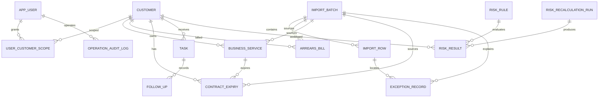

# 当前数据库设计说明

## 1. 核实范围

本说明依据本地数据库 `arrears_management` 的 `information_schema` 只读查询和 `db/migrations/V1__enterprise_arrears_schema.sql` 编制。归档时数据库可连接，未执行 DDL、DML、迁移或数据导出。MySQL 精确发行版尚未确认。

## 2. 表清单与用途

| 表 | 用途 | 主要关系 |
|---|---|---|
| `app_user` | 登录账号、角色和状态 | 被客户、业务、范围、规则、审计等引用 |
| `user_customer_scope` | 客户经理授权客户 | `app_user` 与 `customer` 多对多 |
| `customer` | 客户主数据及汇总展示字段 | 一对多业务、账单、到期、风险、任务 |
| `business_service` | 客户业务/专线 | 属于客户，可关联到期和账单 |
| `arrears_bill` | 欠费账单 | 属于客户，可选关联业务和导入批次 |
| `contract_expiry` | 业务合同到期记录 | 属于客户，可选关联业务 |
| `task` | 督办任务及来源 | 可关联客户、业务、风险来源 |
| `follow_up` | 任务跟进历史 | 多条记录属于一个任务 |
| `import_batch` | 文件导入批次及汇总 | 被业务记录、原始行和风险结果追溯 |
| `import_row` | 文件原始行处理结果 | 属于批次，可生成异常记录 |
| `risk_rule` | 可版本化风险规则 | 被风险结果引用 |
| `risk_recalculation_run` | 一次风险重算运行 | 被风险结果引用 |
| `risk_result` | 某次重算的风险结果 | 关联客户、业务、规则、运行 |
| `exception_record` | 剔除/失败数据核查 | 关联批次和原始行 |
| `operation_audit_log` | 管理和关键业务操作审计 | 可选关联操作用户 |

## 3. 字段基线

以下表格按实际列顺序记录字段。`默认`为数据库查询到的默认值；未列出的默认值为 NULL。

### 3.1 账号与授权

`app_user`：

| 字段 | 类型 | NULL | 默认/含义 |
|---|---|---|---|
| `id` | BIGINT | 否 | 主键，自增 |
| `username` | VARCHAR(100) | 否 | 唯一登录名 |
| `real_name` | VARCHAR(100) | 否 | 展示姓名 |
| `password_hash` | VARCHAR(100) | 否 | 密码哈希，不存明文 |
| `role` | VARCHAR(30) | 否 | `ADMIN` 或 `CUSTOMER_MANAGER` |
| `enabled` | TINYINT(1) | 否 | 1，账号启用状态 |
| `created_at` / `updated_at` | DATETIME | 否 | 当前时间；更新时间自动更新 |

`user_customer_scope`：`id BIGINT` 主键自增；`user_id BIGINT`、`customer_id BIGINT` 非空；`created_at DATETIME` 非空默认当前时间；`created_by BIGINT` 可空。`(user_id,customer_id)` 唯一，另有 `customer_id` 索引。用户、客户、创建人均有外键到相应表。

### 3.2 客户与业务

`customer`：`id BIGINT` 主键自增；`customer_code VARCHAR(100)` 可空且唯一；`customer_name VARCHAR(200)`、`manager_name VARCHAR(100)`、`business_type VARCHAR(100)`、`balance DECIMAL(18,2)`、`risk_status VARCHAR(30)`、`due_summary VARCHAR(200)`、`record_status VARCHAR(30)` 非空，余额默认 0，状态默认 `ACTIVE`；`manager_user_id BIGINT`、`source_batch_id BIGINT` 可空；`created_at`、`updated_at` DATETIME 非空自动维护；另有 `contact_phone VARCHAR(50)`、`customer_address VARCHAR(500)`、`service_count INT`、`source_updated_date DATE`、`data_source VARCHAR(200)`、`remarks TEXT` 可空，`balance_known TINYINT(1)` 非空默认 0。索引为主键、客户编号唯一、经理和风险状态普通索引。实际外键中未发现 `manager_user_id` 和 `source_batch_id` 的约束。

`business_service`：`id BIGINT` 主键自增；`customer_id BIGINT`、`service_code VARCHAR(100)` 非空，后者不是全局唯一而是在客户内唯一；`service_name VARCHAR(200)`、`service_type VARCHAR(100)`、`manager_user_id BIGINT`、`source_batch_id BIGINT` 可空；`status VARCHAR(30)` 非空默认 `ACTIVE`；时间字段自动维护；业务扩展字段为 `bandwidth VARCHAR(100)`、`contract_signed_date DATE`、`service_start_date DATE`、`annual_amount DECIMAL(18,2)`、`last_follow_up_date DATE`、`remarks TEXT`。客户、经理、批次有外键；索引覆盖客户/状态和经理。

`contract_expiry`：`id BIGINT` 主键自增；`customer_id BIGINT`、`expiry_date DATE` 非空；`service_id`、`contract_code`、`source_batch_id` 可空；`renewal_status VARCHAR(30)` 非空默认 `PENDING`；时间字段非空自动维护。实际唯一键为 `(service_id,expiry_date)`，允许 `service_id` NULL 的记录依赖 MySQL NULL 唯一语义；另有日期/状态及客户索引。客户、业务、批次有外键。

### 3.3 欠费

`arrears_bill`：`id BIGINT` 主键自增；`customer_id BIGINT`、`bill_code VARCHAR(100)`、`billing_period VARCHAR(30)`、`due_amount DECIMAL(18,2)`、`paid_amount DECIMAL(18,2)`、`arrears_amount DECIMAL(18,2)` 非空；`paid_amount` 默认 0；`service_id`、`balance_amount`、`bill_date`、`due_date`、`source_batch_id` 可空；`record_status VARCHAR(30)` 默认 `ACTIVE`；另有可空 `bill_status VARCHAR(30)`、`external_batch_code VARCHAR(100)`。金额使用 DECIMAL(18,2)，实际唯一键是 `(customer_id,bill_code,billing_period)`，不是账单号全局唯一。客户、业务和批次有外键；客户/账期及欠费金额有索引。

### 3.4 导入与异常

`import_batch`：`id BIGINT` 主键自增；文件名、来源、状态、行数统计字段非空；文件 SHA-256、幂等键、操作用户和开始/结束时间可空；统计包括 `total_rows`、`valid_rows`、`invalid_rows`、`inserted_rows`、`updated_rows`、`duplicate_rows`、`excluded_rows`、`failed_rows`，默认均为 0。创建时间有索引。当前数据库未查询到文件哈希或幂等键唯一索引，应用层负责重复确认控制。

`import_row`：`id` 主键自增；`batch_id`、`source_row_number`、`row_status`、`row_category` 非空；工作表、业务键、客户编号、客户名、业务描述、金额、到期日、责任人、风险字段、错误码、原始 JSON 等可空；`created_at`、`updated_at` 自动维护。批次有索引和外键。原始行是导入追溯依据，不是正式业务主键。

`exception_record`：`id` 主键自增；异常类型和原因非空，状态默认 `OPEN`；批次、原始行、业务键、处理人、处理时间和解决说明可空。批次、原始行、处理人有外键；批次/状态及类型/状态有索引。

### 3.5 风险与任务

`risk_rule`：`id` 主键自增；规则代码、名称、类型、操作符、版本非空；阈值、有效时间、创建人可空；启用标志非空默认 1；`(rule_code,version)` 唯一，启用/生效时间有索引。创建人有外键。

`risk_recalculation_run`：`id` 主键自增；来源/目标规则版本、范围类型、状态、统计数和发起人非空；范围值、错误消息、结束时间可空；状态/开始时间有索引；发起人有外键。

`risk_result`：`id` 主键自增；客户、规则、规则版本、来源类型、来源记录、风险等级、状态、计算时间、运行号非空；业务、观测值、阈值、批次、复核人和复核时间可空；唯一键为 `(source_record_type,source_record_id,rule_id,run_id)`，另有客户/状态及运行索引。客户、业务、规则、运行、批次、复核人均有外键。风险结果的状态与任务状态分离。

`task`：`id` 主键自增；标题、负责人、截止日、任务状态、优先级、任务类型非空；客户、业务、来源、规则、幂等键、创建人、关闭/完成时间、关闭原因、更新人、来源编码/批次/结果和记录时间可空。当前唯一键为 `(customer_id,source_record_code)`，另有截止日、负责人、状态索引；数据库实际未发现 `rule_id` 等字段的外键约束。自动任务幂等还依赖服务层对来源、规则和未关闭状态的判断。

`follow_up`：`id` 主键自增；任务、备注、创建人和创建时间非空；下一步、来源编码、批次、创建人用户、更新时间可空；任务有索引和外键。该表只追加历史记录，不应被风险重算覆盖。

### 3.6 审计

`operation_audit_log`：`id` 主键自增；操作类型、结果、创建时间非空；操作用户、目标类型、目标 ID、详情可空。操作用户有外键；按操作人/时间和操作类型/时间建索引。当前未发现保留周期或脱敏策略字段。

## 4. 关系图

## 5. 一致性、迁移和恢复

导入确认、风险重算和任务生成应在服务事务边界内完成；唯一键和应用层幂等检查共同防止重复写入。失败时保留批次、原始行和异常原因，正式业务记录不应由客户关联失败行生成。金额校验须拒绝负数、已缴大于应缴等异常，欠费按应缴减已缴计算，但当前归档不把未在代码中确认的舍入规则扩展为新规则。

项目提供增量 SQL，但未自动执行迁移。生产维护应先使用 `mysqldump` 备份并检查备份可读，再执行经过评审的脚本；恢复前应停止写入并在副本验证。任何新增外键或唯一约束都必须先检查存量冲突。
