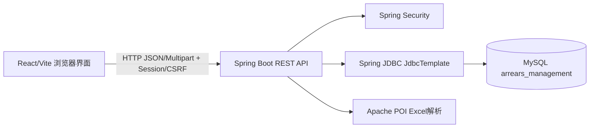

# 项目技术设计与实现说明书

## 1. 文档基本信息

| 项目 | 内容 |
|---|---|
| 项目 | 政企客户欠费与到期管理工具 |
| 文档版本 | 1.0，归档基线 |
| 编制日期 | 2026-10-15 |
| 依据 | 当前源码、配置、迁移脚本、测试和本地数据库只读核查 |
| 数据安全 | 本文不记录密码、令牌或客户明细 |

本说明书描述当前实现，不等同于早期需求或 OpenSpec 规划。状态统一区分为设计目标、实际实现、验证状态和限制。

## 2. 项目概述

系统用于个人电脑本地管理政企客户、业务专线、欠费账单、到期事项和跟进任务。主要输入为 Excel，采用浏览器访问的本地模块化单体后端。当前实现重点是本地登录、客户范围控制、导入追踪、风险识别和任务闭环。

## 3. 当前实现范围

已实现并有测试或浏览器验收依据的范围：登录退出、管理员/客户经理、客户范围、客户台账、业务和到期查询、欠费账单、Excel 只读预检/预览/确认/取消、批次和异常追踪、四条风险规则、风险重算、自动任务、跟进、工作台、管理员账号/范围/规则/审计。

未发现完整实现：外部系统同步、短信/邮件/企业微信、正式报表、通用导出、对外 API 调用方认证、Flyway、Docker、安装包和复杂 RBAC。详情见 [project-facts.md](project-facts.md) 与 [known-issues.md](known-issues.md)。

## 4. 技术栈与依赖

后端是 Java 17、Spring Boot 2.5.15、Spring MVC、Spring Validation、Spring JDBC、Spring Security、Actuator、MySQL Connector/J 和 Apache POI 5.2.5，构建使用 Maven。前端是 React 18.3.1、TypeScript 5.5.4、Vite 5.4.2、Ant Design 5.20.6、TanStack Query 5.59.0、ECharts 5.5.1，使用 npm。

当前未发现 ORM；数据库访问集中在控制器/业务实现使用的 `JdbcTemplate` SQL。默认连接池为 HikariCP。版本依据 `backend/pom.xml`、`frontend/package.json` 和锁定文件。

## 5. 系统架构



后端按业务包组织为 system、permission、customer、ledger、dataingestion、risk、task、audit、common。控制器负责路由和输入边界，SQL 负责当前主要的数据访问；没有独立微服务或消息队列。Excel 在请求处理中解析和预览，确认时写入批次和业务表。

## 6. 目录结构与职责

```text
backend/src/main/java/com/mobiletools/arrears/
  common/       统一响应和异常
  system/       健康、认证、账号、安全初始化
  customer/     客户与台账查询
  ledger/       业务、账单、到期查询
  dataingestion/Excel预检、预览、确认、批次、异常
  risk/         规则、重算、结果、工作台
  task/         任务和跟进
  audit/        审计查询
backend/src/test/  集成测试和业务验收测试
frontend/src/     React入口、API封装、页面组件和样式
db/migrations/    增量数据库脚本
docs/             历史设计、验收记录和本归档文档
openspec/         变更规划和长期规格
scripts/          数据处理辅助脚本
```

关键入口为后端 `ArrearsManagementApplication`、前端 `frontend/src/main.tsx` 和页面编排 `frontend/src/App.tsx`。

## 7. 功能模块与业务流程

### 7.1 登录与权限

登录请求通过 `AuthController` 建立 Session，Security 配置保护业务路径，退出时使 Session 失效。管理员可维护用户启停和客户范围；客户经理只读授权客户，可处理授权范围内任务。密码字段是哈希，不能从数据库恢复明文。

### 7.2 Excel 导入

流程为：只读预检 -> 管理员预览 -> 查看新增/更新/重复/剔除/失败 -> 确认或取消 -> 批次、原始行和异常追踪。客户关联失败只保留在导入剔除/异常记录，不创建正式业务记录。账单金额使用 DECIMAL 数据模型，异常金额由导入校验拒绝。重复执行由文件摘要、业务唯一键和应用层幂等控制共同处理。

### 7.3 风险与任务

风险重算创建运行记录并保存每条规则结果：R001 余额小于 500，R002 累计欠费大于 1000，R003 到期不超过 30 天，R004 任务超期超过 1 天。结果与人工任务、跟进历史分离。风险持续期间不重复生成未关闭任务；风险解除后再次触发形成新周期。自动任务负责人取客户当前责任客户经理，截止日期为风险计算日后 3 个自然日，这是当前已确认的 V1 规则。

### 7.4 工作台与核查

工作台汇总风险、到期、异常和任务。事项跳转时携带客户、日期、状态、批次、工作表、原始行号等条件，后端仍重新执行范围校验，不能只依赖前端参数。

## 8. 数据库设计摘要

数据库共 15 张表，完整字段、类型、约束和 Mermaid ER 图见 [database-design.md](database-design.md)。核心链路为：客户 -> 业务/账单/到期 -> 风险结果 -> 自动任务 -> 跟进；Excel -> 导入批次 -> 原始行/异常 -> 正式业务记录。风险运行、风险结果与任务处理状态分离，避免重算覆盖人工历史。

关键约束包括客户编号唯一、客户内业务编号唯一、客户+账单编号+账期唯一、规则编码+版本唯一、风险结果按来源/规则/运行唯一、用户客户范围唯一。实际外键以数据库查询为准，而不是仅以 Java 模型推断。

## 9. API 与前端

实际路由分组为 `/auth`、`/customers`、`/ledger`、`/imports`、`/workbench`、`/risk-recalculation`、`/risk-rules`、`/tasks`、`/users`、`/audit-logs` 和 `/health`。完整方法、权限和用途见 [api-reference.md](api-reference.md)。

前端组件包括 `Workbench`、`RiskCenter`、`TaskCenter`、`CustomerLedger`、`ImportCenter`、`IssueCenter` 和 `AdminCenter`，通过 `frontend/src/api.ts` 请求后端。原型页面只证明交互参考，当前页面是否可用以真实接口响应和测试为准。

## 10. 安全、日志与运行

默认本地回环监听；Session Cookie 配置 HttpOnly、SameSite，CSRF 通过接口获取。管理员操作、登录和关键导入/规则/任务操作写入 `operation_audit_log`。统一异常处理返回结构化错误，客户范围在服务端 SQL 条件和详情接口中检查。

敏感配置通过环境变量外部化；文档和仓库不得提交密码。当前未发现外部通知、复杂审计保留策略、生产 TLS 或对外 API 鉴权方案。

部署、启动、备份和恢复见 [deployment-guide.md](deployment-guide.md)。

## 11. 测试与验证

后端测试结果为 Maven 60 项通过、1 项跳过；前端 `npm run build` 通过；浏览器导航、工作台、自动风险和完整导入端到端脚本通过。正式数据快照在测试数据清理后保持一致。上述结果来自归档前已执行记录，未将未执行的场景写成通过。

仍需持续验证：真实生产模板长期兼容、MySQL 发行版差异、外部通知、报表导出和部署恢复演练。

## 12. 原始需求与实现差异

| 原始方向 | 当前实现 | 状态 |
|---|---|---|
| 本地轻量单体 | Spring Boot 单体、React 前端、本地 MySQL | 已实现 |
| 五类 Excel 统一处理 | POI 预检、预览、确认、追踪 | 已实现，模板变更待确认 |
| 登录和两类角色 | Session、管理员、客户经理及范围 | 已实现 |
| 四条风险规则 | 规则表、重算、结果和自动任务 | 已实现 |
| 外部数据系统 | 未发现适配器或接口调用实现 | 未实现 |
| 提醒和统计报表 | 未发现完整发送/报表模块 | 未实现 |
| Flyway/复杂权限/微服务 | 未引入 | 暂不引入 |

## 13. 维护建议与索引

维护时先读本文件、`project-facts.md`、`database-design.md` 和 `api-reference.md`，再读对应控制器、前端组件和测试。结构变更应先备份、检查存量冲突、评审增量迁移并更新事实基线。业务规则变更应同时更新规则版本、测试和 OpenSpec 规格。

历史参考文件包括根目录 `project.md`、`README.md`、`docs/` 下 R1/R2 文档、OpenSpec 变更 `openspec/changes/define-local-mvp-requirements-v2` 和 `db/migrations/V1__enterprise_arrears_schema.sql`。
