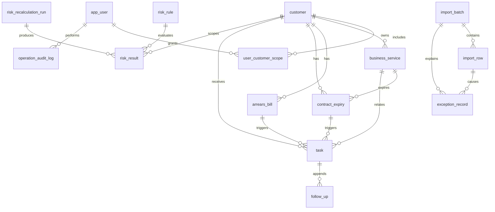

# Design

## Context

当前项目是本地浏览器访问的 React/TypeScript/Vite 前端与 Java 17、Spring Boot 2.5.15、Spring JDBC、MySQL 后端模块化单体。实际数据库已有 `app_user`、`customer`、`task`、`import_batch`、`import_row`、`follow_up` 六张基础表和存量数据；本轮只规划，不执行 DDL、迁移或数据清理。五工作表及五个独立 Excel 文件是 V1 导入契约，`C-10765` 是已确认的客户关联失败样例。

## Goals / Non-Goals

**Goals:**

- 形成页面、接口、数据表、规则和任务之间可追踪的 MVP 设计。
- 在现有表基础上渐进扩展，支持导入幂等、孤立数据剔除、风险可解释和任务闭环。
- 保持本地单体、站内提醒和有限权限，避免无依据的复杂基础设施。

**Non-Goals:**

- 本轮不修改 Java、TypeScript、配置或 SQL，不创建数据库表，不执行迁移。
- 不引入微服务、Redis、消息队列、外部消息渠道、复杂 RBAC 或对外开放 API。
- 不把演示数据、短信内容或未经核查的来源作为正式业务事实。

## Decisions

### 1. Capability and page boundaries

| Capability | 页面/入口 | 核心接口方向 | 主要表 | 任务/验收映射 |
|---|---|---|---|---|
| user-auth-permission | 登录、用户账号、权限范围 | `/api/auth/*`、用户和范围管理 | `app_user`、`user_customer_scope`、`operation_audit_log` | 2、6、7 |
| risk-workbench | 风险工作台 | 概览、筛选、跳转 | `customer`、`arrears_bill`、`contract_expiry`、`risk_result`、`task` | 5.1、5.2 |
| customer-risk-ledger | 客户台账、客户/业务详情 | 查询、详情、历史 | `customer`、`business_service`、`arrears_bill`、`contract_expiry`、`risk_result` | 4.1、4.2 |
| data-ingestion-traceability | 数据接入、批次详情、异常核查 | 预检、预览、确认、批次 | `import_batch`、`import_row`、正式业务表、`exception_record` | 3 |
| follow-up-task-management | 任务中心、任务详情 | 列表、状态、跟进 | `task`、`follow_up`、来源业务表 | 5.3、5.4 |
| risk-rule-and-audit | 规则与权限、重算记录、审计 | 规则、重算、异常、审计 | `risk_rule`、`risk_result`、`risk_recalculation_run`、`exception_record`、`operation_audit_log` | 4.3、4.4、4.5 |

演示页面已有菜单和静态交互不等于正式能力完成；正式页面必须以服务端返回的数据、权限和空状态为准。

#### 1.1 Traceability matrix

下表用于把本变更中的主要需求连接到页面、接口、数据表、实施任务和验收测试。接口名称是规划名称，不代表当前代码已经实现。

| Requirement / capability | 页面与用户操作 | 规划接口 | 主要数据表 | 实施任务 | 验收覆盖 |
|---|---|---|---|---|---|
| `user-auth-permission` | 登录、用户管理、客户范围维护 | `POST /api/auth/login`、`POST /api/auth/logout`、`GET /api/auth/me`、`GET/POST/PATCH /api/users`、`PUT /api/users/{id}/scope` | `app_user`、`user_customer_scope`、`operation_audit_log` | 2.1-2.4、6.2 | 登录、会话、越权、哈希和审计测试 |
| `data-ingestion-traceability` | 数据接入预检、预览、确认、批次详情、异常核查 | `POST /api/imports/precheck`、`GET /api/imports/{id}/preview`、`POST /api/imports/{id}/confirm`、`GET /api/imports/{id}/rows` | `import_batch`、`import_row`、`exception_record` 及正式业务表 | 1.1-1.4、3.1-3.6 | 表头、金额、空值、幂等、`C-10765`、事务回滚 |
| `customer-risk-ledger` | 客户台账、业务/客户详情、历史追溯 | `GET /api/customers`、`GET /api/customers/{id}`、`GET /api/services/{id}` | `customer`、`business_service`、`arrears_bill`、`contract_expiry`、`risk_result` | 4.1-4.2 | 范围过滤、组合查询、空状态、来源历史 |
| `risk-workbench` | 风险工作台筛选、统计卡片和跳转 | `GET /api/workbench/summary`、`GET /api/workbench/items` | `customer`、`risk_result`、`task`、`exception_record` | 5.1-5.2、6.1 | 统计一致性、授权范围、跳转条件 |
| `risk-rule-and-audit` | 规则配置、风险重算、异常与审计查询 | `GET/POST /api/risk-rules`、`POST /api/risk-recalculation-runs`、`GET /api/exceptions`、`GET /api/audit-logs` | `risk_rule`、`risk_result`、`risk_recalculation_run`、`exception_record`、`operation_audit_log` | 4.3-4.5、2.4 | 四条规则边界、重算失败恢复、审计脱敏 |
| `follow-up-task-management` | 任务中心、任务详情、追加跟进、完成/关闭 | `GET/POST /api/tasks`、`PATCH /api/tasks/{id}`、`POST /api/tasks/{id}/follow-ups` | `task`、`follow_up` 及来源业务表 | 5.3-5.5 | 任务幂等、范围、状态流转、跟进追加、逾期 |

### 2. Import pipeline and business identity

处理顺序为：上传解析 -> 工作表/表头预检 -> 字段与金额校验 -> 客户/业务关联 -> 去重分类 -> 预览 -> 管理员确认 -> 事务写入 -> 风险计算。每个批次使用文件 SHA-256 或等价指纹加导入类型防止同一文件重复提交；同文件部分修订时仍以业务唯一键和字段更新策略处理。

当前已确认的候选标识为客户编号、业务编号、账单编号、记录编号和规则编码，但是否全局唯一、是否包含业务周期必须在真实模板确认。推荐业务唯一键如下，均标记为“建议方案，待确认”：

- 客户：`customer_code`。
- 业务：`customer_code + service_code`。
- 账单：`customer_code + bill_code`，若账单编号跨周期复用则增加账期。
- 到期：`service_id + expiry_date`，若合同编号稳定则优先使用合同编号。
- 跟进：`record_code`；正式任务不得仅靠它幂等，而应使用来源对象、规则编码、任务类型和未关闭状态。
- 规则：`rule_code + version`。

Excel 非必填空值默认不覆盖已有有效值；主动清空不属于普通导入，需单独的管理员操作并记录审计。欠费金额保存为 `应缴金额 - 已缴金额` 的数值结果，金额异常、公式无法读取或客户关联失败的行只进入 `import_row`/批次统计，不进入正式账单、任务或台账。

V1 风险规则的比较运算符固定为：余额 `< 500` 元、累计欠费 `> 1000` 元、距离到期 `<= 30` 天、任务超期 `> 1` 天。距离到期和任务超期的当前日期/时间取服务端计算时钟；是否按自然日、是否包含当天及业务时区仍需确认。边界测试必须覆盖等于阈值和刚刚超过/低于阈值的情况。

### 3. Existing tables: retain and extend

下表字段定义来自当前仓库 `backend/src/main/resources/schema.sql`；上线迁移前仍须对运行中的 MySQL 执行只读 `SHOW CREATE TABLE`/索引核查，发现差异以实际库为准。这里不将 SQL 文件等同于当前数据库事实。

#### 3.1 `app_user`

| 字段 | MySQL 类型 | NULL/默认 | 主键/索引 | 含义 |
|---|---|---|---|---|
| `id` | BIGINT | NOT NULL AUTO_INCREMENT | PK | 用户内部主键 |
| `username` | VARCHAR(100) | NOT NULL | `uk_app_user_username` UNIQUE | 登录账号 |
| `password_hash` | VARCHAR(100) | NOT NULL | - | 密码哈希，不存明文 |
| `enabled` | BOOLEAN | NOT NULL DEFAULT TRUE | - | 是否允许登录 |
| `created_at` | DATETIME | NOT NULL DEFAULT CURRENT_TIMESTAMP | - | 创建时间 |
| `updated_at` | DATETIME | NOT NULL DEFAULT CURRENT_TIMESTAMP ON UPDATE CURRENT_TIMESTAMP | - | 更新时间 |

现有表无外键。规划保留主键/唯一账号键，增加 `real_name VARCHAR(100) NOT NULL`、`role VARCHAR(30) NOT NULL`；客户范围由 `user_customer_scope` 表达，不再塞入账号单列。角色仅 `ADMIN`、`CUSTOMER_MANAGER`。是否兼容现有用户角色映射待迁移盘点。

#### 3.2 `customer`

| 字段 | MySQL 类型 | NULL/默认 | 主键/索引 | 含义 |
|---|---|---|---|---|
| `id` | BIGINT | NOT NULL AUTO_INCREMENT | PK | 内部主键 |
| `customer_name` | VARCHAR(200) | NOT NULL | - | 客户名称 |
| `manager_name` | VARCHAR(100) | NOT NULL | `idx_customer_manager` | 当前演示负责人名称 |
| `business_type` | VARCHAR(100) | NOT NULL | - | 当前演示业务类型 |
| `balance` | DECIMAL(18,2) | NOT NULL DEFAULT 0 | - | 当前演示余额摘要 |
| `risk_status` | VARCHAR(30) | NOT NULL | `idx_customer_risk_status` | 当前演示风险摘要 |
| `due_summary` | VARCHAR(200) | NOT NULL | - | 当前演示到期摘要 |
| `created_at` | DATETIME | NOT NULL DEFAULT CURRENT_TIMESTAMP | - | 创建时间 |
| `updated_at` | DATETIME | NOT NULL DEFAULT CURRENT_TIMESTAMP ON UPDATE CURRENT_TIMESTAMP | - | 更新时间 |

现有表没有客户业务编号、唯一约束或外键；不能按客户名称推断唯一客户。规划增加 `customer_code VARCHAR(100) NULL`、`manager_user_id BIGINT NULL`、`source_batch_id BIGINT NULL`、`record_status VARCHAR(30) NOT NULL DEFAULT 'ACTIVE'`，分别表示来源客户编号、负责人、来源批次和正式记录状态。`customer_code` 的唯一范围未确认前不建立唯一键，导入阶段必须依赖已确认的匹配规则。`balance`、`risk_status`、`due_summary` 是摘要字段，正式数据迁移前需决定保留兼容还是停止写入。负责人和来源批次外键均禁止级联删除。

#### 3.3 `task`

| 字段 | MySQL 类型 | NULL/默认 | 主键/索引 | 含义 |
|---|---|---|---|---|
| `id` | BIGINT | NOT NULL AUTO_INCREMENT | PK | 任务主键 |
| `title` | VARCHAR(300) | NOT NULL | - | 标题 |
| `owner_name` | VARCHAR(100) | NOT NULL | `idx_task_owner` | 当前负责人名称文本 |
| `deadline` | DATE | NOT NULL | `idx_task_deadline` | 截止日期 |
| `task_status` | VARCHAR(30) | NOT NULL | `idx_task_status` | 状态 |
| `priority` | VARCHAR(20) | NOT NULL | - | 优先级 |
| `created_at` | DATETIME | NOT NULL DEFAULT CURRENT_TIMESTAMP | - | 创建时间 |
| `updated_at` | DATETIME | NOT NULL DEFAULT CURRENT_TIMESTAMP ON UPDATE CURRENT_TIMESTAMP | - | 更新时间 |

现有表无客户/业务/来源外键，无幂等唯一键。规划补充客户、业务及来源对象引用、创建人、完成/关闭信息和规则触发信息；先迁移存量映射，不能把任务标题当业务唯一键。

建议扩展字段如下，均为“建议方案，待确认”：

| 字段 | 类型 | NULL/默认 | 约束与含义 |
|---|---|---|---|
| `customer_id` | BIGINT | NULL | FK `customer.id`；历史孤立任务可暂为空，正式新任务必须有值 |
| `service_id` | BIGINT | NULL | FK `business_service.id`；没有业务粒度时为空 |
| `source_type` | VARCHAR(40) | NULL | `RISK_RESULT`、`ARREARS_BILL`、`CONTRACT_EXPIRY`、`MANUAL` 等 |
| `source_record_id` | BIGINT | NULL | 来源记录 ID；因多态来源不设置单一 FK |
| `task_type` | VARCHAR(40) | NOT NULL DEFAULT `'FOLLOW_UP'` | 任务类型 |
| `rule_id` | BIGINT | NULL | FK `risk_rule.id`；手工任务为空 |
| `idempotency_key` | VARCHAR(160) | NULL | 系统任务的规范化来源对象、规则、任务类型和触发周期哈希；手工任务为空 |
| `created_by` | BIGINT | NULL | FK `app_user.id`；存量任务可为空 |
| `completed_at` | DATETIME | NULL | 进入已完成状态的时间 |
| `closed_at` | DATETIME | NULL | 进入已关闭状态的时间 |
| `close_reason` | VARCHAR(1000) | NULL | 关闭原因或结论 |
| `updated_by` | BIGINT | NULL | 最后修改人 FK `app_user.id` |

新增客户/业务/规则/用户外键并禁止级联删除；建议索引 `(customer_id, task_status)`、`(owner_name, task_status, deadline)`、`(source_type, source_record_id, task_status)`，系统任务的 `idempotency_key` 建唯一索引但允许手工任务为 NULL。状态变更以行锁或版本条件保护并发，具体乐观锁字段是否需要在实现评审确定。

#### 3.4 `import_batch`

| 字段 | MySQL 类型 | NULL/默认 | 主键/索引 | 含义 |
|---|---|---|---|---|
| `id` | BIGINT | NOT NULL AUTO_INCREMENT | PK | 批次主键 |
| `file_name` | VARCHAR(255) | NOT NULL | - | 上传文件名 |
| `source_type` | VARCHAR(50) | NOT NULL | - | 数据类别 |
| `import_status` | VARCHAR(30) | NOT NULL | - | 批次状态 |
| `total_rows` | INT | NOT NULL DEFAULT 0 | - | 总行数 |
| `valid_rows` | INT | NOT NULL DEFAULT 0 | - | 当前有效行数 |
| `invalid_rows` | INT | NOT NULL DEFAULT 0 | - | 当前无效行数 |
| `created_at` | DATETIME | NOT NULL DEFAULT CURRENT_TIMESTAMP | `idx_import_batch_created_at` | 创建时间 |

建议扩展字段如下，均为“建议方案，待确认”：

| 字段 | 类型 | NULL/默认 | 含义与约束 |
|---|---|---|---|
| `sheet_name` | VARCHAR(100) | NULL | 工作表名；独立文件可为空 |
| `file_sha256` | CHAR(64) | NULL | 文件内容指纹 |
| `idempotency_key` | VARCHAR(160) | NULL | 文件指纹、导入类型和模板版本组合值 |
| `operator_user_id` | BIGINT | NULL | 操作者 FK `app_user.id`；存量批次可为空 |
| `started_at` | DATETIME | NULL | 开始解析/写入时间 |
| `finished_at` | DATETIME | NULL | 批次结束时间 |
| `inserted_rows` | INT | NOT NULL DEFAULT 0 | 新增正式记录数 |
| `updated_rows` | INT | NOT NULL DEFAULT 0 | 更新正式记录数 |
| `duplicate_rows` | INT | NOT NULL DEFAULT 0 | 重复未写入记录数 |
| `excluded_rows` | INT | NOT NULL DEFAULT 0 | 客户关联失败等剔除数 |
| `failed_rows` | INT | NOT NULL DEFAULT 0 | 校验或写入失败数 |

建议索引 `(source_type, file_sha256)` 和 `(import_status, created_at)`；如 `idempotency_key` 定义稳定，则增加唯一键，重复确认返回原批次结果而不重复落库。批次状态只能按 `PRECHECKED -> CONFIRMED/REJECTED/FAILED` 等明确状态流转，具体枚举待实现评审确定。

#### 3.5 `import_row`

| 字段 | MySQL 类型 | NULL/默认 | 主键/索引/外键 | 含义 |
|---|---|---|---|---|
| `id` | BIGINT | NOT NULL AUTO_INCREMENT | PK | 行记录主键 |
| `batch_id` | BIGINT | NOT NULL | `idx_import_row_batch`; FK `fk_import_row_batch` | 批次 |
| `source_row_number` | INT | NOT NULL | - | 原始行号 |
| `customer_id` | VARCHAR(100) | NULL | - | 来源客户编号文本 |
| `customer_name` | VARCHAR(200) | NULL | - | 来源客户名称 |
| `business_description` | VARCHAR(300) | NULL | - | 来源业务描述 |
| `arrears_amount` | DECIMAL(18,2) | NULL | - | 来源欠费金额 |
| `balance_amount` | DECIMAL(18,2) | NULL | - | 来源余额 |
| `due_date` | DATE | NULL | - | 来源到期日 |
| `owner_name` | VARCHAR(100) | NULL | - | 来源负责人 |
| `risk_level` | VARCHAR(30) | NULL | - | 来源风险级别 |
| `processing_status` | VARCHAR(30) | NULL | - | 来源处理状态 |
| `source_description` | VARCHAR(300) | NULL | - | 来源说明 |
| `risk_note` | VARCHAR(500) | NULL | - | 来源风险备注 |
| `row_status` | VARCHAR(30) | NOT NULL | - | 行处理状态 |
| `error_message` | VARCHAR(500) | NULL | - | 错误原因 |
| `created_at` | DATETIME | NOT NULL DEFAULT CURRENT_TIMESTAMP | - | 创建时间 |

建议扩展字段如下：

| 字段 | 类型 | NULL/默认 | 含义 |
|---|---|---|---|
| `sheet_name` | VARCHAR(100) | NOT NULL | 工作表名或独立文件映射名 |
| `business_key` | VARCHAR(300) | NULL | 规范化后的候选业务标识 |
| `row_category` | VARCHAR(30) | NOT NULL DEFAULT `'VALID'` | INSERT/UPDATE/DUPLICATE/CONFLICT/EXCLUDED/INVALID |
| `error_code` | VARCHAR(60) | NULL | 稳定错误编码 |
| `raw_payload` | JSON | NULL | 可选的脱敏原始值，仅在安全评审允许时保存 |
| `updated_at` | DATETIME | NOT NULL DEFAULT CURRENT_TIMESTAMP ON UPDATE CURRENT_TIMESTAMP | 行处理更新时间 |

增加唯一键 `(batch_id, sheet_name, source_row_number)`，以及 `(batch_id, row_category)`、`(business_key)` 索引。`raw_payload` 不得保存密码、令牌或不必要的完整敏感文件内容。该表仅保存导入过程数据，不作为正式账单。

#### 3.6 `follow_up`

| 字段 | MySQL 类型 | NULL/默认 | 主键/索引/外键 | 含义 |
|---|---|---|---|---|
| `id` | BIGINT | NOT NULL AUTO_INCREMENT | PK | 跟进主键 |
| `task_id` | BIGINT | NOT NULL | `idx_follow_up_task`; FK `fk_follow_up_task` | 所属任务 |
| `note` | TEXT | NOT NULL | - | 跟进内容 |
| `created_by` | VARCHAR(100) | NOT NULL | - | 当前操作者名称文本 |
| `created_at` | DATETIME | NOT NULL DEFAULT CURRENT_TIMESTAMP | - | 记录时间 |

建议扩展字段：`created_by_user_id BIGINT NULL`、`next_action VARCHAR(1000) NULL`、`source_record_code VARCHAR(160) NULL`、`source_batch_id BIGINT NULL`、`updated_at DATETIME NOT NULL DEFAULT CURRENT_TIMESTAMP ON UPDATE CURRENT_TIMESTAMP`。`created_by_user_id` 外键指向 `app_user.id`，`source_batch_id` 外键指向 `import_batch.id`，均禁止级联删除；索引 `(task_id, created_at)` 和 `source_record_code`。历史行不可由新导入覆盖，删除任务不得级联删除跟进记录。空值的 `next_action` 允许，但 `note` 与 `next_action` 不得同时为空。

### 4. Planned relational model

字段表以下是可实施的推荐模型；除显式注明默认值外，`NOT NULL` 字段不设置数据库默认值，插入时由业务明确提供；`NULL` 字段默认 NULL。`created_at` 建议 `DATETIME NOT NULL DEFAULT CURRENT_TIMESTAMP`，`updated_at` 建议 `DATETIME NOT NULL DEFAULT CURRENT_TIMESTAMP ON UPDATE CURRENT_TIMESTAMP`。带“待确认”的字段语义必须以真实 Excel 和业务确认结果为准。公共字段只在确有生命周期需要的表中使用，不强制所有表统一逻辑删除。

#### 4.1 `user_customer_scope`

| 字段 | 类型 | NULL/默认 | 含义 |
|---|---|---|---|
| `id` | BIGINT | NOT NULL AUTO_INCREMENT | 主键 |
| `user_id` | BIGINT | NOT NULL | `app_user.id` |
| `customer_id` | BIGINT | NOT NULL | `customer.id` |
| `created_at` | DATETIME | NOT NULL CURRENT_TIMESTAMP | 授权时间 |
| `created_by` | BIGINT | NULL | 授权人 |

PK `id`；FK `user_id -> app_user.id`、`customer_id -> customer.id`，均 `ON DELETE RESTRICT`；唯一键 `uk_scope_user_customer(user_id, customer_id)`；索引 `idx_scope_customer(customer_id)`。用户与客户多对多。撤销方式和是否保留历史待确认。

#### 4.2 `business_service`

| 字段 | 类型 | NULL/默认 | 含义 |
|---|---|---|---|
| `id` | BIGINT | NOT NULL AUTO_INCREMENT | 主键 |
| `customer_id` | BIGINT | NOT NULL | 客户外键 |
| `service_code` | VARCHAR(100) | NOT NULL | 业务编号，作用域待确认 |
| `service_name` | VARCHAR(200) | NULL | 业务名称 |
| `service_type` | VARCHAR(100) | NULL | 业务类型 |
| `manager_user_id` | BIGINT | NULL | 负责人 |
| `status` | VARCHAR(30) | NOT NULL DEFAULT 'ACTIVE' | 业务状态 |
| `source_batch_id` | BIGINT | NULL | 来源批次 |
| `created_at` | DATETIME | NOT NULL DEFAULT CURRENT_TIMESTAMP | 创建时间 |
| `updated_at` | DATETIME | NOT NULL DEFAULT CURRENT_TIMESTAMP ON UPDATE CURRENT_TIMESTAMP | 更新时间 |

PK `id`；FK `customer_id -> customer.id`、`manager_user_id -> app_user.id`、`source_batch_id -> import_batch.id`，删除均 `RESTRICT` 或可空来源 `SET NULL`；建议唯一键 `uk_service_customer_code(customer_id, service_code)`。在业务编号作用域未确认前，该唯一键只作为建议，正式迁移不得直接启用。索引客户、负责人和状态。客户一对多业务。

#### 4.3 `arrears_bill`

| 字段 | 类型 | NULL/默认 | 含义 |
|---|---|---|---|
| `id` | BIGINT | NOT NULL AUTO_INCREMENT | 主键 |
| `customer_id` | BIGINT | NOT NULL | 客户外键 |
| `service_id` | BIGINT | NULL | 业务外键，待确认 |
| `bill_code` | VARCHAR(100) | NOT NULL | 账单编号 |
| `billing_period` | VARCHAR(30) | NULL（待确认） | 账期；若唯一性依赖账期，确认后必须改为 NOT NULL |
| `due_amount` | DECIMAL(18,2) | NOT NULL | 应缴金额，>=0 |
| `paid_amount` | DECIMAL(18,2) | NOT NULL DEFAULT 0 | 已缴金额，>=0 |
| `arrears_amount` | DECIMAL(18,2) | NOT NULL | `due_amount-paid_amount`，由服务端计算 |
| `balance_amount` | DECIMAL(18,2) | NULL | 余额，规则待确认 |
| `bill_date`/`due_date` | DATE | NULL | 账单/应缴日期 |
| `source_batch_id` | BIGINT | NULL | 来源批次 |
| `record_status` | VARCHAR(30) | NOT NULL DEFAULT 'ACTIVE' | 正式状态 |
| `created_at` | DATETIME | NOT NULL DEFAULT CURRENT_TIMESTAMP | 创建时间 |
| `updated_at` | DATETIME | NOT NULL DEFAULT CURRENT_TIMESTAMP ON UPDATE CURRENT_TIMESTAMP | 更新时间 |

PK `id`；FK 客户、业务、来源批次分别指向 `customer`、`business_service`、`import_batch`，正式业务外键 `RESTRICT`，来源批次可 `SET NULL`；推荐唯一键 `uk_bill_customer_code_period(customer_id,bill_code,billing_period)`，但 MySQL 唯一键允许多个 NULL，故账期为空且唯一规则未确认时不得依赖该键去重，须阻止正式导入或先确认可用的非空唯一键。索引客户、业务、账期和欠费金额。账单与客户多对一。

#### 4.4 `contract_expiry`

| 字段 | 类型 | NULL/默认 | 含义 |
|---|---|---|---|
| `id` | BIGINT | NOT NULL AUTO_INCREMENT | 主键 |
| `customer_id` | BIGINT | NOT NULL | 客户外键 |
| `service_id` | BIGINT | NULL | 业务外键 |
| `contract_code` | VARCHAR(100) | NULL | 合同编号，待确认 |
| `expiry_date` | DATE | NOT NULL | 到期日期 |
| `renewal_status` | VARCHAR(30) | NOT NULL DEFAULT 'PENDING' | 续签状态 |
| `source_batch_id` | BIGINT | NULL | 来源批次 |
| `created_at` | DATETIME | NOT NULL DEFAULT CURRENT_TIMESTAMP | 创建时间 |
| `updated_at` | DATETIME | NOT NULL DEFAULT CURRENT_TIMESTAMP ON UPDATE CURRENT_TIMESTAMP | 更新时间 |

PK `id`；FK 客户、业务和来源批次分别指向 `customer`、`business_service`、`import_batch`，业务外键 `RESTRICT`、来源可 `SET NULL`；推荐唯一键必须基于确认后的非空业务标识，不能依赖可空的 `service_id`/`contract_code` 组合（MySQL 唯一索引允许多组 NULL）。索引到期日和续签状态。历史到期记录不物理覆盖；唯一性未确认时冲突行阻止正式写入。

#### 4.5 `risk_rule`

| 字段 | 类型 | NULL/默认 | 含义 |
|---|---|---|---|
| `id` | BIGINT | NOT NULL AUTO_INCREMENT | 主键 |
| `rule_code` | VARCHAR(60) | NOT NULL | 规则编码 |
| `rule_name` | VARCHAR(150) | NOT NULL | 规则名称 |
| `rule_type` | VARCHAR(40) | NOT NULL | 规则类型 |
| `threshold_value` | DECIMAL(18,2) | NULL | 金额或天数阈值 |
| `operator` | VARCHAR(10) | NOT NULL | LT/GT/LTE |
| `version` | INT | NOT NULL | 规则版本 |
| `is_enabled` | BOOLEAN | NOT NULL DEFAULT TRUE | 是否启用 |
| `effective_from`/`effective_to` | DATETIME | NULL | 生效区间 |
| `created_by` | BIGINT | NULL | 创建人 |
| `created_at` | DATETIME | NOT NULL | 创建时间 |

PK `id`；FK `created_by -> app_user.id`，删除限制或保留空值；唯一键 `uk_rule_code_version(rule_code,version)`；索引启用状态和生效时间。V1 初始化四条规则，修改只产生新版本。

#### 4.6 `risk_result`

| 字段 | 类型 | NULL/默认 | 含义 |
|---|---|---|---|
| `id` | BIGINT | NOT NULL AUTO_INCREMENT | 主键 |
| `customer_id` | BIGINT | NOT NULL | 客户外键 |
| `service_id` | BIGINT | NULL | 业务外键 |
| `rule_id` | BIGINT | NOT NULL | 规则外键 |
| `rule_version` | INT | NOT NULL | 计算使用的不可变规则版本 |
| `source_record_type` | VARCHAR(40) | NOT NULL | BILL/EXPIRY/TASK |
| `source_record_id` | BIGINT | NOT NULL | 来源 ID |
| `observed_value` | DECIMAL(18,2) | NULL | 触发值 |
| `threshold_value` | DECIMAL(18,2) | NULL | 阈值快照 |
| `risk_level` | VARCHAR(20) | NOT NULL | 风险等级 |
| `status` | VARCHAR(30) | NOT NULL | ACTIVE/CLEARED/REVIEW |
| `calculated_at` | DATETIME | NOT NULL | 计算时间 |
| `run_id` | BIGINT | NOT NULL | 本次计算运行 |
| `source_batch_id` | BIGINT | NULL | 来源批次快照；手工或重算来源可为空 |
| `reviewed_by`/`reviewed_at` | BIGINT/DATETIME | NULL | 人工核查 |
| `created_at` | DATETIME | NOT NULL DEFAULT CURRENT_TIMESTAMP | 创建时间 |

PK `id`；FK `customer_id -> customer.id`、`service_id -> business_service.id`、`rule_id -> risk_rule.id`、`run_id -> risk_recalculation_run.id`、`source_batch_id -> import_batch.id` 及核查人至 `app_user.id`；业务对象删除限制，非必需关联允许空值。`run_id` 只由 `risk_result` 指向 `risk_recalculation_run`，运行表不反向设置外键，避免循环依赖。唯一键 `uk_risk_source_rule_run(source_record_type,source_record_id,rule_id,run_id)`；另索引客户/状态、规则/计算时间、`run_id` 和来源批次。多态来源暂不设直接外键，实施前可改为类型专用 nullable FK。每次计算写入新的运行快照；工作台只读取最近一次成功运行，失败运行保留但不替换当前有效结果。风险结果是派生状态，不保存任务人工处理状态。

#### 4.7 `risk_recalculation_run`

| 字段 | 类型 | NULL/默认 | 含义 |
|---|---|---|---|
| `id` | BIGINT | NOT NULL AUTO_INCREMENT | 主键 |
| `rule_version_from`/`rule_version_to` | VARCHAR(100) | NOT NULL | 规则版本范围 |
| `scope_type` | VARCHAR(30) | NOT NULL | ALL/CUSTOMER/RULE |
| `scope_value` | VARCHAR(200) | NULL | 范围值 |
| `status` | VARCHAR(30) | NOT NULL | RUNNING/SUCCEEDED/FAILED |
| `total_count`/`success_count`/`failure_count` | INT | NOT NULL DEFAULT 0 | 统计 |
| `error_message` | VARCHAR(1000) | NULL | 失败摘要 |
| `started_at` | DATETIME | NOT NULL DEFAULT CURRENT_TIMESTAMP | 执行开始时间 |
| `finished_at` | DATETIME | NULL | 执行结束时间 |
| `started_by` | BIGINT | NOT NULL | 操作人 |

PK `id`；FK `started_by -> app_user.id`，风险结果通过 `run_id` 回指本表；索引状态和开始时间。失败记录保留，重试创建新的运行记录或按明确幂等键恢复。运行创建、结果快照写入和成功状态提交应分阶段处理：失败运行提交失败统计和错误摘要，但不得替换最近一次成功运行的工作台结果。

#### 4.8 `exception_record`

| 字段 | 类型 | NULL/默认 | 含义 |
|---|---|---|---|
| `id` | BIGINT | NOT NULL AUTO_INCREMENT | 主键 |
| `batch_id` | BIGINT | NULL | 导入批次 |
| `source_row_id` | BIGINT | NULL | 导入行 |
| `exception_type` | VARCHAR(50) | NOT NULL | ORPHAN/AMOUNT/CONFLICT/RISK/OTHER |
| `business_key` | VARCHAR(300) | NULL | 业务标识 |
| `reason` | VARCHAR(1000) | NOT NULL | 原因 |
| `status` | VARCHAR(30) | NOT NULL DEFAULT 'OPEN' | 状态 |
| `resolution` | VARCHAR(1000) | NULL | 处理结论 |
| `handled_by`/`handled_at` | BIGINT/DATETIME | NULL | 处理信息 |
| `created_at` | DATETIME | NOT NULL | 创建时间 |

PK `id`；FK `batch_id -> import_batch.id`、`source_row_id -> import_row.id` 和 `handled_by -> app_user.id`，允许无批次的运行异常但不得级联删除；索引批次、类型、状态和业务标识。`C-10765` 只保留在导入追溯和异常记录。

#### 4.9 `operation_audit_log`

| 字段 | 类型 | NULL/默认 | 含义 |
|---|---|---|---|
| `id` | BIGINT | NOT NULL AUTO_INCREMENT | 主键 |
| `operator_user_id` | BIGINT | NULL | 操作者 |
| `operation_type` | VARCHAR(60) | NOT NULL | LOGIN/IMPORT/RULE/SCOPE/EXPORT/REVIEW |
| `target_type`/`target_id` | VARCHAR(60)/BIGINT | NULL | 目标 |
| `result` | VARCHAR(30) | NOT NULL | SUCCESS/FAIL |
| `detail` | VARCHAR(2000) | NULL | 脱敏摘要 |
| `created_at` | DATETIME | NOT NULL DEFAULT CURRENT_TIMESTAMP | 操作时间 |

PK `id`；FK `operator_user_id -> app_user.id`，账号注销时允许置空；索引操作者、类型、目标和时间。目标使用多态引用不设外键。禁止写入密码、令牌和完整敏感文件内容；保留周期待确认。

### 5. Core ER relationship

### 6. Transactions, concurrency and recovery

- 导入确认以批次为事务边界；业务写入、批次统计、行状态和风险触发记录必须一致，失败时回滚或明确失败批次。
- 预检阶段不写正式业务表；确认接口校验批次状态、操作者权限和幂等指纹，防止重复提交。
- 使用数据库唯一键兜底，服务层捕获重复键并转为重复/冲突结果，不靠前端判断。
- 任务创建在客户范围校验、来源存在和未关闭任务查询之后执行，并使用唯一约束或锁避免并发重复。
- 风险重算使用独立运行记录和规则版本快照；失败可重试，不覆盖 `task`/`follow_up`。
- 外键使用 InnoDB、相同类型和必要索引；外键删除策略以禁止级联删除业务记录为原则。
- 金额字段使用 `DECIMAL(18,2)`；正式迁移时为应缴、已缴、欠费金额增加非负约束，并由服务层再次校验 `arrears_amount = due_amount - paid_amount`，避免仅依赖数据库 `CHECK`。
- 日期字段使用 `DATE` 表示业务日期，`DATETIME` 表示操作、计算和审计时刻；所有服务端比较使用同一时区配置。
- 迁移顺序应先补充可空兼容字段和索引，再回填并核验存量，最后才将已确认的业务标识改为 `NOT NULL` 或唯一约束。
- 建表迁移工具、原始文件保留位置、备份频率和恢复演练仍为待确认事项；本轮不引入或执行。

## Risks / Trade-offs

- [业务唯一性未最终确认] -> 先使用候选键和唯一约束设计，实施前以真实 Excel 样例确认是否增加账期/合同周期。
- [现有简化表与正式模型不一致] -> 先做字段映射和存量数据盘点，禁止直接重建或删除存量。
- [规则重算与任务重复] -> 风险结果和任务分离，以来源、规则、类型和未关闭状态控制幂等。
- [导入失败导致批次不明] -> 保留行级状态、原因和事务结果，提供明确的失败/回滚状态。
- [Spring Boot 2.5.15 维护风险] -> 本变更不升级版本，另行评估兼容性、测试和迁移成本。

## Migration Plan

1. 先冻结真实 Excel 字段、唯一性、空值覆盖和规则版本契约。
2. 对现有六表和存量数据做只读盘点，形成映射和回滚备份方案。
3. 评审本设计后，再选择数据库版本化迁移工具并编写迁移脚本。
4. 先实现导入预检和批次追溯，再实现正式台账、风险和任务闭环。
5. 任何迁移失败均停止正式写入，按备份恢复并保留失败日志；本轮不执行。

## Open Questions

### Confirmed automatic task policy

用户已确认：R001/R002/R003在成功重算事务内自动建单，负责人为客户当前有效责任客户经理，截止日期为数据库当前日期后3个自然日；R004关联原逾期任务，不递归建单。同来源、规则编码、任务类型存在未关闭任务时复用；持续风险对应任务已结束时不重建，成功重算确认风险解除后再次触发才允许新周期。规则版本变化本身不构成新周期。负责人缺失或停用写异常。使用现有source_type、source_record_id、rule_id、idempotency_key字段保存来源及首次触发风险ID；规则行锁串行保护重算与自动建单，任务和风险发布共用保存点，失败一起回滚。人工记录不被自动修改。

- 客户编号、业务编号、账单编号和合同编号是否全局唯一，账单是否必须带账期。
- 五类 Excel 的实际表头、必填字段、日期格式和空值主动清空规则。
- `customer_scope` 是否采用 `user_customer_scope` 明细表，以及范围变更是否保留历史。
- 到期记录以合同编号、业务编号还是业务与到期日组合作为唯一性。
- 规则修改后默认全量重算、按客户重算还是仅新数据重算。
- 自动触发规则按上述已确认策略执行，仍保留手工创建入口。
- 原始 Excel 保留位置、数据库备份频率、审计保留周期和 MySQL 迁移工具。
